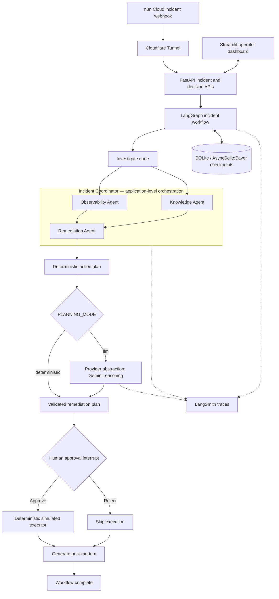
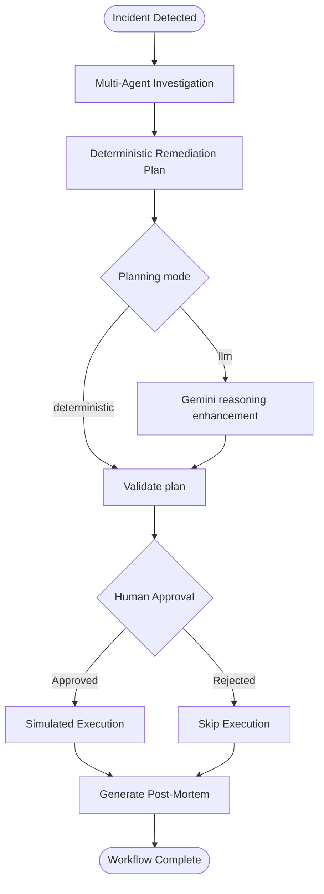

# Multi-Agent Incident Response System

**UCLA Agentic AI Capstone — Architecture & Technical Analysis**

## Purpose and scope

This prototype investigates incidents using three specialized agents, produces evidence-conditioned remediation plans, requires explicit operator approval, and records **simulation-only** remediation outcomes. Both approved and rejected workflows generate a Markdown post-mortem. The system supports a deterministic baseline and optional **Gemini-assisted root-cause reasoning** through a provider abstraction. The Remediation Agent still selects actions deterministically; the LLM can enhance the hypothesis and action explanations, but does not authorize execution. No production infrastructure is modified.

## 1. System architecture

**Architectural boundary:** The three specialized agents run *inside* the Coordinator, invoked by LangGraph's `investigate` node; they are not individual LangGraph nodes. The execution engine is a deterministic simulator, **not** a fourth agent. LangSmith traces the coordinator, agents, and the instrumented Gemini provider call; inference occurs through the external Gemini API.

### Component responsibilities

| Component | Responsibility |
| --- | --- |
| Observability Agent | Analyze incident metrics and logs; report findings, evidence, gaps and telemetry-coverage confidence. |
| Knowledge Agent | Retrieve relevant historical incidents and runbooks using lexical matching; report evidence and retrieval strength. |
| Remediation Agent | Synthesize diagnostics into a root-cause hypothesis and ordered actions with risk, rationale and prerequisites. |
| Incident Coordinator | Dispatch Observability and Knowledge concurrently, invoke deterministic Remediation, optionally enhance the plan with Gemini, validate it, and handle partial failures. |
| Optional LLM provider | Use configured Gemini model to propose a richer evidence-based root-cause hypothesis; on provider/parse failures, retain deterministic reasoning. |
| LangGraph | Manage investigation, HITL interrupt/resume, decision routing, post-mortem generation and durable state. |
| FastAPI | Expose incident creation, state retrieval and human decision endpoints. |
| Streamlit | Display investigation, approval controls, simulated results and downloadable post-mortem. |
| Simulated executor | Validate approval, supported actions and prerequisites; return simulation-only results. |
| SQLite / AsyncSqliteSaver | Persist incident workflow checkpoints by `thread_id` across backend restarts. |
| LangSmith | Capture workflow and instrumented agent traces. |
| n8n / Cloudflare Tunnel | Optionally ingest external alerts into a locally running FastAPI service. |

## 2. End-to-end workflow

The following diagram shows the two human-decision branches and their shared post-mortem step.

1. An operator or n8n webhook submits an incident to FastAPI.
2. LangGraph creates a unique `thread_id` and enters `investigate`.
3. The Coordinator runs Observability and Knowledge concurrently with `asyncio.gather`, then invokes deterministic Remediation using their findings. When `PLANNING_MODE=llm`, the optional Gemini provider can enhance the hypothesis before schema validation; deterministic mode skips the LLM.
4. The plan includes prioritized actions, risk classifications, prerequisites and an explicit approval requirement.
5. LangGraph pauses at `interrupt()`; the operator approves or rejects through Streamlit/FastAPI, which resumes the workflow using `Command(resume=...)`.
6. **Approved:** the allowlisted, prerequisite-aware simulator records outcomes. **Rejected:** no remediation actions execute.
7. Both branches enter the `postmortem` node, generating a Markdown report; LangGraph then completes.

## 3. Planning, coordination and safety

### Deterministic evidence-conditioned planning

The planner uses defined evidence patterns and action templates rather than an open-ended generative model. For checkout degradation, database connection-pool saturation can trigger a low-risk connection verification action; a recent deployment may additionally justify proposing a higher-risk simulated rollback, dependent on the verification step. Action rationale and dependencies are inspectable.

### Optional Gemini-assisted reasoning and mode selection

- `PLANNING_MODE=deterministic`: retain the rule-based root-cause hypothesis and deterministic action plan; no Gemini call is expected.
- `PLANNING_MODE=llm` with `LLM_PROVIDER=gemini`: call the configured Gemini model through `backend/agents/remediation_llm.py` and the generic `backend/llm/` provider interface.
- In both modes, the deterministic planner controls action IDs, ordering, risks and prerequisites; the coordinator enforces `execution_allowed=False` and validates the resulting `RemediationPlan`.
- The enhancement function is designed to fall back to the original plan on model, parsing or validation failure. A successful model span alone does not establish that the enhanced plan passed validation.
- The demonstrated INC-001 LangSmith run on November 4, 2026 included a successful **Gemini Remediation Reasoning** LLM span (~10.50 seconds); its `root_cause_hypothesis` matched the final post-mortem.
- This is **LLM-assisted explanation**, not autonomous action generation or independent proof of the hypothesis.

### Failure handling

- If Knowledge fails, a conservative telemetry-only diagnostic plan can be produced instead of riskier remediation.
- If Observability fails, the fallback requests more telemetry rather than recommending higher-impact changes.
- Missing or invalid action prerequisites are rejected rather than silently ignored.
- Confidence scores reflect heuristic signal coverage and retrieval strength; they are **not** calibrated probabilities of root-cause correctness.

### Human control

Plans require human approval before execution. LangGraph pauses at an approval interrupt, and the simulator independently enforces approval, allowlisted action types and prerequisite completion. Rejection bypasses the simulator entirely. These safeguards are suitable for a capstone demonstration, not a substitute for production authorization or change-management controls.

## 4. Post-mortem reporting

The `postmortem` LangGraph node runs after either decision outcome and uses `backend/tools/postmortem_generator.py` to assemble a draft Markdown report from the incident, Coordinator findings, plan, human decision and available simulated execution results. Reports can be saved under `data/postmortems/` and displayed/downloaded from Streamlit.

A report includes incident overview, findings from all three agents, probable root cause (deterministic or LLM-enhanced), prioritized remediation actions and risks, human approval decision, simulation outcomes (or an explicit statement that rejection prevented execution), limitations and follow-up actions. A post-mortem is a **draft**; its hypotheses are not independently verified production diagnoses.

### Demonstrated INC-001 outcomes

| Scenario | Decision | Execution | Post-mortem |
| --- | --- | --- | --- |
| Checkout degradation — approved | `approved` | ACT-001 and ACT-002 reported `simulated_success` | Generated with agent findings and simulation results |
| Checkout degradation — rejected | `rejected` | No actions executed | Generated with agent findings and explicit rejection outcome |
| Checkout degradation — Gemini-assisted, approved | `approved` | ACT-001 and ACT-002 reported `simulated_success` | Gemini hypothesis matched the post-mortem; LLM invocation visible in LangSmith |

The successful simulation does not establish that real service recovery occurred.

## 5. Technology and persistence

- **Python** — agent logic and backend.
- **FastAPI** — HTTP API and LangGraph lifecycle.
- **LangGraph** — workflow state, approval interrupt/resume and routing.
- **Streamlit** — operator dashboard.
- **SQLite, `aiosqlite`, `AsyncSqliteSaver`** — local durable checkpoints.
- **LangSmith** — workflow, agent and Gemini LLM span visibility.
- **Google Gen AI SDK (`google-genai`)** — optional Gemini inference via provider abstraction.
- **n8n Cloud and Cloudflare Tunnel** — optional webhook integration.
- **pytest** — automated verification.

The workflow checkpoint is keyed by `thread_id`; a paused incident can be reloaded and resumed after FastAPI restarts, provided the SQLite checkpoint file is preserved. SQLite is appropriate for a local prototype, not a distributed high-availability deployment.

## 6. Reliability and verification

Reported tests include end-to-end investigation, approved and rejected HITL paths, Knowledge Agent failure fallback, invalid prerequisite protection, LangSmith agent traces, SQLite restart recovery, and post-mortem generation for both decision outcomes. The automated pytest suite was previously reported passing; exact counts should be taken from the final test run.

For a concise demonstration, show the investigation findings, prerequisite-aware plan, approval/rejection branch, post-mortem report, agent traces and checkpoint recovery. Never describe simulated outcomes as real infrastructure changes.

## 7. Technical analysis and tradeoffs

| Decision | Advantage | Limitation |
| --- | --- | --- |
| Three specialized agents | Clear diagnostic and planning responsibilities | Requires response contracts and coordination |
| Parallel diagnostic agents | Reduces independent investigation latency | Partial failures and trace-context complexity |
| Deterministic remediation planner | Reproducible, auditable and testable action selection | Limited generalization beyond defined evidence patterns |
| Optional Gemini reasoning | Richer hypotheses with supporting context, visible in LangSmith | Added latency, API dependency and potential unsupported claims |
| LangGraph HITL | Explicit approval boundary and resumability | Adds state/checkpoint lifecycle complexity |
| Lexical incident retrieval | Simple, transparent retrieval | Can miss semantic matches |
| SQLite checkpointing | Lightweight local persistence | Not distributed or highly available |
| Simulation-only executor | Safe demonstration and predictable tests | Does not prove real-world remediation efficacy |
| Draft post-mortem | Makes evidence and decisions reviewable | Requires operator validation before operational use |

### Limitations and future work

The system has no production infrastructure integrations and no open-ended autonomous replanning. Gemini is an **optional**, mode-gated external dependency; deterministic mode remains available without it. Security, role-based authorization, idempotency, audit retention, concurrent execution controls and operational verification would need strengthening for production use. Future enhancements could include evidence-citation validation for LLM claims, explicit runtime LLM/fallback metadata in post-mortems, semantic/hybrid retrieval, richer incident benchmarks, topological dependency scheduling, distributed checkpoints and independently validated post-action telemetry.

---

