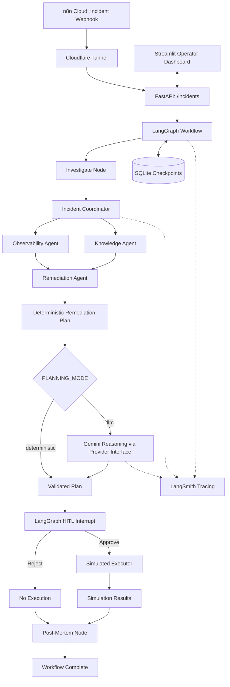

# Multi-Agent Incident Response System

**UCLA Agentic AI Capstone Project**

An incident-response prototype that coordinates specialized diagnostic agents, generates deterministic evidence-based remediation plans with **optional Gemini-assisted root-cause reasoning**, and requires explicit human approval before **simulated** remediation. Both approval and rejection paths generate a downloadable Markdown post-mortem. The application combines an n8n incident-ingestion workflow, FastAPI, LangGraph, a Streamlit operator dashboard, SQLite checkpointing, and LangSmith tracing.

> **Safety:** This is a demonstration system. Remediation actions are simulated; it does not restart production services, roll back live deployments, or modify infrastructure.

## Features

- **Three specialized agents:** Observability, Knowledge, and Remediation.
- **Parallel diagnosis:** Observability and Knowledge run concurrently; Remediation runs after their responses are available.
- **Evidence-conditioned planning:** Produces prioritized deterministic remediation actions with risks, rationales, prerequisites, and rollback descriptions.
- **Selectable reasoning modes:** `PLANNING_MODE=deterministic` skips the LLM; `PLANNING_MODE=llm` can use the configured Gemini provider to enrich the root-cause hypothesis while retaining deterministic actions.
- **LLM observability:** A successful Gemini provider invocation and matching post-mortem hypothesis were verified in LangSmith for INC-001.
- **Adaptive fallback:** Agent failures can lead to diagnostic-only plans instead of riskier remediation actions.
- **Dependency validation:** Rejects remediation plans with missing prerequisites.
- **Human-in-the-loop (HITL):** LangGraph pauses for an explicit approve/reject decision before simulated execution.
- **Durable workflow state:** SQLite-backed LangGraph checkpoints support resuming a paused incident after a FastAPI restart.
- **Traceability:** LangSmith records LangGraph runs and instrumented agent activity.
- **Operator UI:** Streamlit displays investigation results, proposed actions, and approval controls.
- **Webhook ingestion:** n8n can validate an incident alert and submit it to FastAPI.
- **Post-mortem reporting:** Both approved and rejected decisions generate an evidence-based Markdown report with agent findings, proposed actions, operator decision, and simulation outcome; Streamlit displays and downloads the report.

## Architecture



The diagram is logical: the agents are invoked **inside the Coordinator**, which runs inside the LangGraph `investigate` node. They are not separate LangGraph nodes. The Streamlit dashboard communicates with FastAPI, and n8n reaches the local backend through a tunnel in the demonstrated setup.

### Agent responsibilities

| Component | Responsibility | Inputs | Outputs |
| --- | --- | --- | --- |
| **Observability Agent** | Analyze logs and metrics; identify telemetry-based hypotheses | Incident logs and metrics | Findings, evidence, missing signals, confidence |
| **Knowledge Agent** | Search historical incidents and retrieve associated runbooks | Incident context | Similar incidents, runbooks, retrieval evidence |
| **Remediation Agent** | Combine diagnostic responses and build a safe action plan | Observability and Knowledge responses | Root-cause hypothesis, prioritized actions, planning trace |
| **Incident Coordinator** | Dispatch agents, optionally enhance reasoning with Gemini, validate plan and handle partial failures | Incident | Combined agent responses and remediation plan |
| **Optional Gemini provider** | Generate an evidence-based hypothesis without controlling executable actions | Incident evidence and deterministic plan | Enhanced hypothesis and optional rationales |
| **LangGraph** | Manage investigation, approval, execution routing, and state | Incident and human decision | Durable workflow state |
| **Simulation Executor** | Validate approval, allowlisted actions, and prerequisites | Approved plan | Simulated action results |
| **Post-Mortem Generator** | Assemble investigation evidence, decision and outcomes into a Markdown draft | Incident, coordinator findings, plan, workflow state | Report text and saved Markdown file |

### Workflow

1. An incident is submitted through FastAPI, either directly from Streamlit or via n8n.
2. LangGraph starts a workflow under a unique `thread_id`.
3. The Coordinator dispatches Observability and Knowledge concurrently.
4. The Remediation Agent builds a deterministic evidence-conditioned plan, with dependencies and an approval requirement. When `PLANNING_MODE=llm`, the coordinator optionally calls Gemini to enrich the hypothesis, then validates the plan before approval.
5. LangGraph interrupts the workflow at the human-approval checkpoint.
6. An operator **approves** or **rejects** the plan.
7. On approval, the executor validates the plan and records **simulation-only** results; on rejection, no remediation runs.
8. Both branches enter the `postmortem` node, which generates a Markdown draft. Streamlit shows the report and offers a download.
9. LangGraph persists state in SQLite and emits traces to LangSmith when configured.

## Technology stack

- **Python** — backend and agent logic
- **FastAPI** — incident and decision APIs
- **LangGraph** — stateful orchestration and HITL interrupts
- **LangSmith** — workflow, agent and instrumented Gemini LLM traces
- **Google Gen AI SDK (`google-genai`)** — optional Gemini provider
- **Streamlit** — operator dashboard
- **SQLite / `aiosqlite` / `AsyncSqliteSaver`** — persistent checkpoints
- **n8n Cloud** — alert webhook workflow
- **Cloudflare Tunnel** — exposes local FastAPI to n8n for the demo
- **pytest** — automated tests

## Repository layout

The key files used by the implementation include:

```text
multi-agent-incident-response/
├── backend/
│   ├── main.py                       # FastAPI application and graph lifecycle
│   ├── agents/
│   │   ├── observability_agent.py
│   │   ├── knowledge_agent.py
│   │   ├── remediation_agent.py
│   │   └── remediation_llm.py           # Optional LLM reasoning enhancement
│   ├── llm/                            # Provider abstraction and Gemini adapter
│   │   ├── base.py
│   │   ├── factory.py
│   │   └── providers/
│   │       └── gemini.py
│   ├── coordinator/
│   │   ├── coordinator_agent.py         # Confirm actual filename in repository
│   │   ├── handoff.py
│   │   └── state.py
│   ├── models/
│   │   ├── incident.py
│   │   └── remediation.py
│   ├── protocols/
│   │   └── messages.py
│   ├── tools/
│   │   ├── log_analyzer.py
│   │   ├── metrics_analyzer.py
│   │   ├── incident_search.py
│   │   ├── remediation_planner.py
│   │   └── postmortem_generator.py
│   ├── workflows/
│   │   ├── incident_graph.py
│   │   └── hitl.py
│   └── persistence/
│       └── checkpointer.py
├── dashboard/
│   └── app.py
├── data/
│   ├── checkpoints/                 # SQLite DB created/used at runtime
│   └── postmortems/                 # Generated Markdown reports
└── tests/
```

Other data files, configuration files, and fixtures may be present in the repository. Confirm the layout against the final commit before submission.

## Local setup

### Prerequisites

- Python and `pip` (use the Python version specified by your final dependency configuration)
- A terminal and Git
- Optional: LangSmith account/API key for tracing
- Optional: n8n Cloud and Cloudflare Tunnel for webhook demonstration

### 1. Clone and create a virtual environment

```bash
git clone <YOUR_GITHUB_REPOSITORY_URL>
cd multi-agent-incident-response
python3 -m venv .venv
source .venv/bin/activate
```

On Windows, activate with `.venv\Scripts\activate`.

### 2. Install dependencies

If your repository includes `requirements.txt`:

```bash
python -m pip install --upgrade pip
python -m pip install -r requirements.txt
```

**Before publishing:** Ensure `requirements.txt` exists and includes all packages required by the backend, dashboard, tests, and tracing. Do not assume the dependency list is complete until installation is tested in a fresh environment.

### 3. Configure environment variables

Create a local `.env` file in the repository root:

```dotenv
INCIDENT_API_KEY=replace-with-a-long-random-local-demo-key
LANGSMITH_TRACING=true
LANGSMITH_PROJECT=multi-agent-incident-response
LANGSMITH_API_KEY=replace-with-your-langsmith-key
INCIDENT_CHECKPOINT_DB=data/checkpoints/incident_workflows.sqlite
PLANNING_MODE=deterministic
LLM_PROVIDER=gemini
LLM_MODEL=gemini-3.8-flash
GEMINI_API_KEY=replace-with-your-gemini-key
```

Set `PLANNING_MODE=llm` to enable Gemini-assisted reasoning, then restart FastAPI. `LLM_PROVIDER` selects the provider; it does not by itself enable LLM mode. `LLM_MODEL` is the model identifier verified in your environment; check availability for other accounts. The API key protects incident endpoints. LangSmith variables enable tracing when loaded into the FastAPI process. **Never commit `.env`, API keys, or private incident data.**

> **Configuration note:** Verify whether your FastAPI startup explicitly loads `.env` (for example, through application settings). If it does not, export the variables in your shell or start Uvicorn with `--env-file .env`.

### 4. Start FastAPI

```bash
uvicorn backend.main:app --reload --host 127.0.0.1 --port 8000 --env-file .env
```

The local API will be available at `http://127.0.0.1:8000`. FastAPI initializes the LangGraph workflow and SQLite checkpointer during application startup.

### 5. Start Streamlit

In a second terminal, activate the same virtual environment and run:

```bash
streamlit run dashboard/app.py --server.port 8502
```

Open `http://localhost:8502` in your browser. Configure the dashboard's backend URL/API key according to the settings exposed by the implementation.

## API examples

Use the same `INCIDENT_API_KEY` configured in the backend. Examples assume a locally available incident fixture named `INC-001`.

### Start an investigation

```bash
curl -X POST http://127.0.0.1:8000/incidents \
  -H 'Content-Type: application/json' \
  -H 'X-API-Key: YOUR_API_KEY' \
  -d '{"incident_id":"INC-001"}'
```

Save the returned `thread_id`. Each new investigation receives a distinct thread ID, even for the same incident fixture.

### Retrieve current state

```bash
curl -H 'X-API-Key: YOUR_API_KEY' \
  'http://127.0.0.1:8000/incidents/YOUR_THREAD_ID'
```

A paused workflow should report `"next_nodes": ["approval"]` when awaiting a human decision.

### Approve a remediation plan

```bash
curl -X POST \
  'http://127.0.0.1:8000/incidents/YOUR_THREAD_ID/decision' \
  -H 'Content-Type: application/json' \
  -H 'X-API-Key: YOUR_API_KEY' \
  -d '{"decision":"approve","approved_by":"capstone_operator"}'
```

### Reject a remediation plan

For a **different incident thread** still awaiting approval:

```bash
curl -X POST \
  'http://127.0.0.1:8000/incidents/ANOTHER_THREAD_ID/decision' \
  -H 'Content-Type: application/json' \
  -H 'X-API-Key: YOUR_API_KEY' \
  -d '{"decision":"reject","approved_by":"capstone_operator"}'
```

The workflow should finish without executing remediation actions, but still generate a post-mortem report. An already-resolved thread cannot be used to test rejection.

## Verify Gemini invocation in LangSmith

1. Start FastAPI with `LANGSMITH_TRACING=true`, `PLANNING_MODE=llm`, `LLM_PROVIDER=gemini`, and valid API keys.
2. Start a **new** INC-001 investigation thread. Completed LangGraph threads should not be reused to test a different planning mode.
3. In [LangSmith](https://smith.langchain.com/), open project `multi-agent-incident-response`, select **Runs**, and locate **Gemini Remediation Reasoning**.
4. Open the successful LLM span and inspect its input and output. Compare `root_cause_hypothesis` with Section 3 of the generated post-mortem.
5. Repeat with `PLANNING_MODE=deterministic`; no Gemini provider call should occur.

**Observed result (November 4, 2026):** The LangSmith run list showed a successful Gemini Remediation Reasoning span (~10.50 s), a successful Incident Coordinator span (~10.66 s), and a LangGraph investigation (~10.73 s). The Gemini `root_cause_hypothesis` matched the generated report. This verifies LLM invocation and application of its hypothesis, but not independent factual correctness of all claims.

For a durable audit, consider recording `planning_mode`, `llm_provider`, `llm_status` and `fallback_used` from runtime execution rather than inferring them from `.env` or report wording. These fields are **recommended enhancements**, not asserted current output.

## Demonstration scenarios

| Scenario | Trigger | Expected behavior |
| --- | --- | --- |
| **INC-001: Checkout degradation** | High latency, HTTP errors, database pool saturation, recent deployment | Propose connection verification and simulated rollback, subject to approval |
| **INC-001: Gemini-assisted** | Run a new incident thread with `PLANNING_MODE=llm` | Preserve deterministic actions; enrich root-cause hypothesis and record a Gemini LLM trace |
| **INC-002: Suspicious authentication** | Elevated failed login activity | Propose authentication review and simulated rate limiting, subject to approval |
| **Human rejection** | Reject a pending plan | Skip simulated execution; generate a post-mortem documenting rejection |
| **Human approval** | Approve a pending plan | Run allowlisted simulated actions; generate a post-mortem documenting outcomes |
| **Knowledge Agent unavailable** | Controlled failure injection/test | Use a telemetry-only diagnostic fallback; exclude riskier remediation |
| **Missing prerequisite** | Controlled invalid dependency/test | Reject the invalid plan and report an error; do not execute |
| **Backend restart** | Pause at HITL, restart FastAPI, resume using the same thread ID | Recover state from SQLite and continue after approval |

**Failure injection is for tests/demo only.** Restore normal agent behavior and valid dependencies after demonstrating the failure scenarios.

## Post-mortem reporting

After either decision, LangGraph routes to `postmortem_node`. The generator in `backend/tools/postmortem_generator.py` assembles incident metadata, findings from all three agents, the root-cause hypothesis, action risks and prerequisites, the human decision, and any simulation results. On rejection it explicitly states that no remediation actions were executed.

The report is returned in workflow state as `postmortem_report`, with an optional saved-file path (`postmortem_path`). The Streamlit dashboard renders the Markdown and provides a download button. Generated files are written to `data/postmortems/` by the generator. Reports are drafts based on available evidence, not proof of production recovery.

To verify, start **separate** INC-001 threads, approve one and reject the other; confirm each produces a report and only the approved thread has simulation results.

## Human-in-the-loop safety

The Remediation Agent proposes actions but **never authorizes execution**. The workflow uses LangGraph `interrupt()` to pause at the approval step and `Command(resume=...)` to continue after a valid decision. The simulator also enforces:

- `approved=True`
- Plan-level and action-level approval requirements
- An allowlist of supported simulated actions
- Unique action IDs and valid prerequisites
- Dependency completion before recording each action

Successful simulated action outcomes are labeled `simulated_success` and `simulation_only=true`. A simulation result does not prove that a real operational remediation would succeed.

## Persistence and recovery

The application uses LangGraph's asynchronous SQLite checkpointer, with a database at:

```text
data/checkpoints/incident_workflows.sqlite
```

The `thread_id` identifies the workflow checkpoint. To demonstrate recovery:

1. Start `INC-001` and wait for HITL approval.
2. Copy its `thread_id`.
3. Stop and restart FastAPI **without deleting the SQLite database**.
4. Retrieve the existing thread and confirm the next node is `approval`.
5. Approve the same thread and inspect the simulated execution results.

This restart/resume scenario was manually verified during development.

## Observability and planning trace

With LangSmith enabled, open [LangSmith](https://smith.langchain.com/), select the `multi-agent-incident-response` project, and inspect recent runs. The implementation has demonstrated traces for LangGraph and the three specialized agents.

The Gemini provider `generate()` method can be instrumented with `@traceable(name="Gemini Remediation Reasoning", run_type="llm")` to show the actual provider invocation. A coordinator-level trace alone does not prove the LLM was called. The remediation planning trace can expose the chosen strategy, agent statuses, root-cause hypothesis, action hierarchy, priorities, risks, prerequisites, and evidence sources. This is a **structured decision explanation**, not a claim to expose an LLM's private chain of thought.

Depending on how tracing context propagates through the dispatcher, individual agent runs may appear as separate traces rather than nested child spans.

## n8n webhook integration (optional)

The demonstrated n8n workflow consists of four nodes:

1. **Incident Alert Webhook** — accepts the alert.
2. **Validate Incident Alert** — validates incoming fields.
3. **Start Incident Investigation** — posts the incident to FastAPI with `X-API-Key`.
4. **Return Incident Result** — returns the backend response.

Because n8n Cloud cannot directly reach `localhost`, the demo uses a **Cloudflare Tunnel** to expose the FastAPI service. Configure the n8n HTTP Request node with the tunnel's current public URL and the correct API key. Tunnel URLs may change between sessions.

Example n8n webhook paths used during development:

```text
/webhook-test/capstone-incident-alert
/webhook/capstone-incident-alert
```

Do not hard-code a temporary tunnel URL or publish credentials in an exported n8n workflow.

## Run automated tests

From the repository root:

```bash
python -m pytest tests/ -v
```

The full test suite was reported passing during development. Manual validation also covered approval, rejection, knowledge-agent failure fallback, missing prerequisite handling, LangSmith traces, and SQLite restart persistence. The exact test count and test names should be taken from the final test run. The approved and rejected post-mortem paths were also demonstrated with complete agent findings and correct execution/no-execution outcomes.

## Design decisions and tradeoffs

| Decision | Benefit | Tradeoff |
| --- | --- | --- |
| Specialized agents | Clear responsibility boundaries | More coordination and response contracts |
| Parallel Observability + Knowledge | Reduced diagnosis latency | Partial failures and tracing-context complexity |
| Deterministic evidence-conditioned planner | Predictable, auditable action selection | Fixed templates; limited dynamic replanning |
| Optional Gemini reasoning | Richer hypotheses while preserving deterministic action controls | API latency, cost, fallbacks and evidence-validation requirements |
| LangGraph + HITL | Explicit approval boundary and resumable state | More workflow and checkpoint management |
| SQLite checkpointing | Simple local durability | Not a distributed high-availability store |
| Simulation-only execution | Safe to demonstrate | Does not validate real infrastructure recovery |
| Lexical historical-incident retrieval | Simple and inspectable | Less semantic flexibility than embedding-based retrieval |

### Planning paradigm

The system uses **predefined workflow orchestration with evidence-conditioned hierarchical remediation planning**. The Coordinator dispatches two independent diagnostic tasks in parallel, then hands their results to the Remediation Agent. The planner chooses among rule-defined remediation branches and produces an inspectable ordered set of actions with dependencies. Failure-aware fallback changes the plan when diagnostic evidence is unavailable.

This is **adaptive rule-based action planning** with optional LLM-assisted reasoning, not an open-ended generative action planner or a general autonomous replanning loop. Gemini is not required in deterministic mode.

## Limitations and future work

- The current remediation planner selects from predefined evidence patterns and action templates; Gemini enriches explanations but does not select executable actions.
- Gemini-generated claims should be checked against source telemetry and historical incident records; model output is not proof of causality.
- Confidence values represent heuristic telemetry coverage and retrieval strength; they are **not calibrated probabilities** of root-cause correctness.
- Historical incident retrieval is lexical rather than full semantic/vector retrieval.
- The simulation executor records planned action outcomes; it does not call real infrastructure control planes. Post-mortems are generated from workflow evidence and do not independently verify service recovery.
- SQLite is suitable for a local prototype, not necessarily for multi-instance production deployment.
- A production implementation would need stronger identity and authorization controls, audit retention, secrets management, idempotency, approval policies, and real post-action verification.
- Potential enhancements include richer evidence scoring, dependency-aware replanning, additional fault-injection tests, semantic retrieval, stronger post-mortem quality checks, and distributed checkpoint storage.


